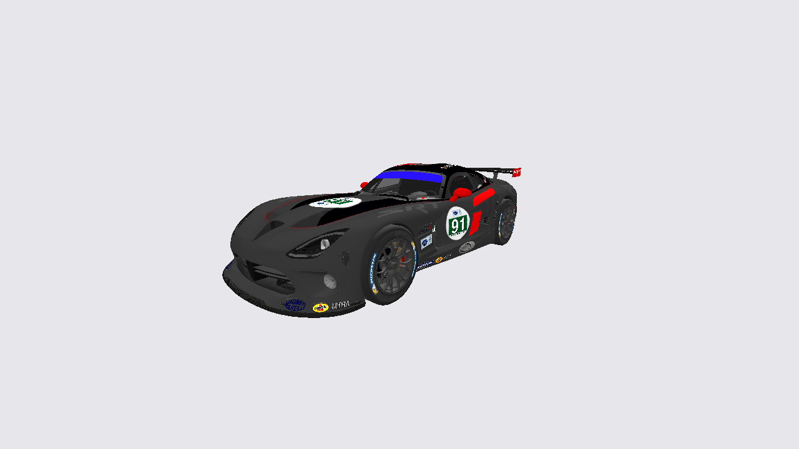
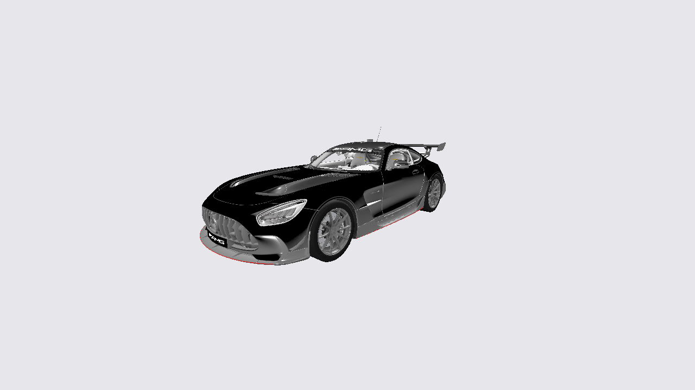
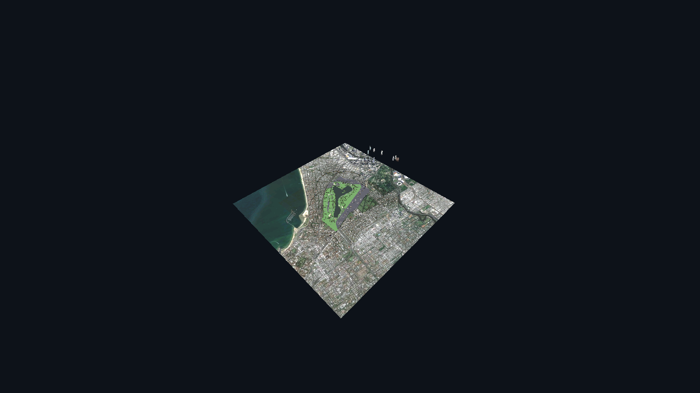

# Assetto Corsa to Godot 4 Converter (GLB + PBR)

Универсальный и автономный конвертер модов из **Assetto Corsa** (машины + трассы) в чистый формат **glTF 2.0 Binary (`.glb`)** для **Godot 4.x**.

Никаких тяжелых текстовых `.tscn` на сотни мегабайт — прямой экспорт в бинарный `.glb` с валидной геометрией, правильными осями, PBR-материалами и батчингом.

---

## 📸 Скриншоты рендеров в Godot 4.3

### 1. Dodge Viper GTS-R (87 730 тр. / 7.7 МБ GLB)


### 2. Mercedes-AMG GT3 2020 (1 407 294 тр. / 60 МБ GLB)


### 3. Трасса Albert Park Melbourne F1 2025 (2 303 534 тр. / 224 МБ GLB)


---

## 📦 Скачать готовые `.glb` модели

Все сконвертированные модели выложены в [Releases](../../releases/tag/v1.0.0):
* 🚗 **`viper_srt.glb`** (7.7 МБ) — Dodge Viper GTS-R (ливрея #91, PBR, интерьер, колеса).
* 🚗 **`mercedes_amg_gt2020.glb`** (60 МБ) — Mercedes-AMG GT 2020 (1.4M полигонов, скин-меши).
* 🏁 **`albert_park_melbourne_2025.glb`** (224 МБ) — Полная трасса Формулы-1 с озером, парком, 367 сбатченными узлами и 766k полигонами коллизии.
* 🏁 **`montreal_gp.glb`** (116 МБ) — Трасса Circuit Gilles Villeneuve (Монреаль, шикана, Стена чемпионов, PBR асфальт, коллизия).
* 🏁 **`monza_2022.glb`** (154 МБ) — Автодром Autodromo Nazionale Monza 2022 (Curva Grande, Параболика, исторический бэнкинг, мульти-KN5).

---

## ⚡ Особенности и математическое ядро

### 1. Координаты и Winding Order (Без зеркальных искажений)
* **Трассы (TRACK):** Координаты `(x, y, z)`, нормали `(nx, ny, nz)`, UV и порядок индексов треугольников `(i0, i1, i2)` переносятся из KN5 **1:1** без инверсии знаков осей.
* **Машины (CAR):** В AC перед смотрит в `+Z` (левый борт `+X`), в Godot — перед в `-Z` (правый борт `+X`). Разворот выполняется чистым поворотом на 180° вокруг оси Y:
  $$\text{ROT\_180\_Y} = \operatorname{diag}(-1, 1, -1, 1) \implies (x, y, z) \to (-x, y, -z)$$
  Определитель матрицы равен **+1**, порядок обхода вершин не нарушается, нормали не выворачиваются, правый руль остается справа, левый — слева.
* Машина автоматически выравнивается по высоте так, что нижняя точка шин касается $y = 0$.
* Проверено соответствие квадрантов узлов колес:
  - `WHEEL_LF`: $x < 0, z < 0$
  - `WHEEL_RF`: $x > 0, z < 0$
  - `WHEEL_LR`: $x < 0, z > 0$
  - `WHEEL_RR`: $x > 0, z > 0$

### 2. PBR-материалы (AC Shaders -> glTF 2.0 PBR)
* **Альфа-канал:** Для непрозрачных материалов (`BlendMode == 0`) альфа-канал диффузной текстуры (в AC это specular mask) отбрасывается во избежание полупрозрачности кузова/асфальта. Стекла (`ksWindscreen`) конвертируются в `alphaMode: BLEND`, растительность (`ksTree`) — в `alphaMode: MASK` (`alphaCutoff: 0.4`).
* **Normal Maps:** Инверсия зеленого канала (`G = 255 - G`) для перехода из DirectX в OpenGL формат.
* **Metallic-Roughness:** Сборка текстуры из AC `txMaps`:
  - `Roughness = 255 - txMaps.G` (инверсия glossiness)
  - `Metallic = txMaps.B`
* **Краска кузова:** Автоматически помечается расширением `KHR_materials_clearcoat` (`clearcoatFactor: 1.0`).

### 3. Оптимизация и батчинг трасс (TRACK Pipeline)
* **Изоляция CAR vs TRACK:** Раздельные пайплайны обработки. Машины сохраняют иерархию dummy-колёс и подвески (`WHEEL_*`, `STEER_*`, `SUSP_*`). Трассы сохраняют все уровни детализации `KSLAYER1..5` (спецтехника, краны, посты маршалов, трибуны) и отсекают исключительно дамми-маркеры (`AC_START_*`, `AC_PIT_*`, `AC_TIME_*`).
* **Мульти-KN5 архитектура:** Автоматическое объединение моделей из `models.ini` / `models_*.ini` (как в Монце из 4 файлов KN5). Пул текстур и материалов объединяется без потерь и перезаписей.
* **Физические контейнеры:** Файлы коллизии (`phy.kn5`, `fisica.kn5`, `2_2022.kn5` и др.) изолируются в узел `Collision` и не накладываются поверх визуального асфальта, полностью исключая Z-fighting и серые ступеньки.
* **Запекание ksMultilayer для PBR:** Многослойные асфальтовые шейдеры (`ksMultilayer*`) комбинируют макро-текстуру с усредненными цветами детальных карт (`txDetailR/G/B/A`) по маске `txMask`, исключая слепящий белый пересвет на солнце.
* **Деревья и растительность:** Принудительное выравнивание нормалей строго вверх `(0, 1, 0)` обеспечивает равномерное освещение крестообразных билбордов крон без деления на черные и зеленые половины.
* **Накат и следы резины:** Дорожные декали (`groove`, `skid`) транслируются в честный `alphaMode: BLEND` с микро-смещением по нормали `+0.005`, предотвращая артефакты триангуляции и Z-fighting.

---

## 🎮 Godot 4 Модули (`godot_importer/`)

Для глубокой кастомизации рендера прямо в Godot 4 проект включает модульный набор скриптов и шейдеров:
* `core/track_scene_builder.gd` — сборка графа сцены (`Visuals`, `Physics`, `TrackSpec`).
* `materials/ac_shader_router.gd` — мастер-классификатор 6 семейств шейдеров AC (`Multilayer`, `MultiMap`, `Tree_Foliage`, `Alpha_Cutout`, `Decal_Alpha`, `Opaque_PBR`).
* `materials/ac_material_factory.gd` — фабрика материалов с авто-пробросом параметров (`multR/G/B/A`, `ksDiffuse`, `ksAlphaRef`).
* `physics/ac_collision_builder.gd` — авто-генерация `StaticBody3D` + `ConcavePolygonShape3D` по стандарту имён Kunos `^[1-9]+[A-Z_]+` с коэффициентами трения из `surfaces.ini`.
* `spec/ac_spawn_extractor.gd` — извлечение стартовой решётки, пит-боксов и тайминг-створов в узел `TrackSpec`.

---

## 🚀 Установка и запуск

### Требования
* Python 3.10+
* `numpy`, `Pillow`, `texture2ddecoder`
* Системный `unrar` / `7z` для распаковки модов

```bash
python3 -m venv .venv
source .venv/bin/activate
pip install numpy pillow texture2ddecoder
```

### Использование CLI
Конвертер принимает как папку с модом, так и архив (`.zip`, `.7z`, `.rar`):

```bash
# Импорт машины
python tools/ac_importer.py path/to/car_mod.rar --id my_car --out sim/assets

# Импорт трассы с выбором конфигурации
python tools/ac_importer.py path/to/track_mod.zip --id albert_park --layout layout_f1_2025 --out sim/assets
```

Результат:
```
sim/assets/
  ├── cars/<id>/
  │     ├── car.glb
  │     └── meta.json
  └── tracks/<id>/
        ├── track.glb
        └── meta.json
```

---

## 🛠 Структура репозитория

```
├── acimport/
│   ├── kn5.py         # Бинарный парсер формата KN5 (Actools spec)
│   ├── gltf.py        # Сборщик чистого GLB (glTF 2.0 Binary)
│   ├── scene.py       # Логика сборки сцен машин и трасс
│   ├── materials.py   # Конвертер шейдеров AC в glTF PBR
│   ├── textures.py    # Декодер DDS (BC1/BC3/BC5/BC7) -> PNG/JPEG
│   ├── geometry.py    # Математика нормалей, тангенсов и winding order
│   ├── inifile.py     # Парсер ini/lut файлов физики и моделей
│   └── verify.py      # Валидатор структуры и нормалей GLB
├── tools/
│   ├── ac_importer.py # Главный CLI конвертера
│   └── preview_glb.py # Автономный софтверный превьювер
├── screenshots/       # Скриншоты и рендеры моделей
└── tests/             # Модульные и интеграционные тесты
```
